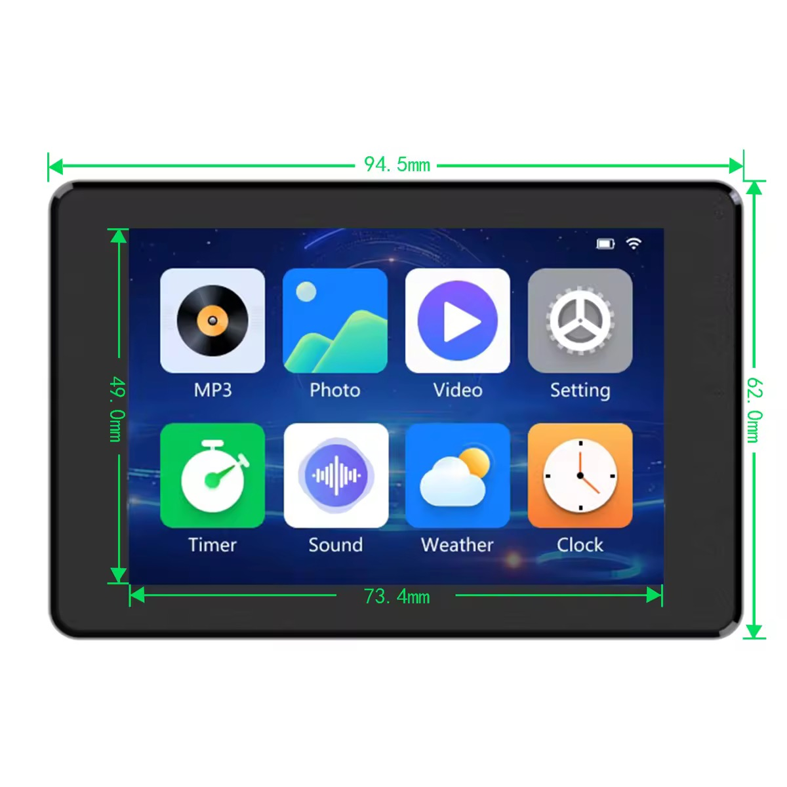
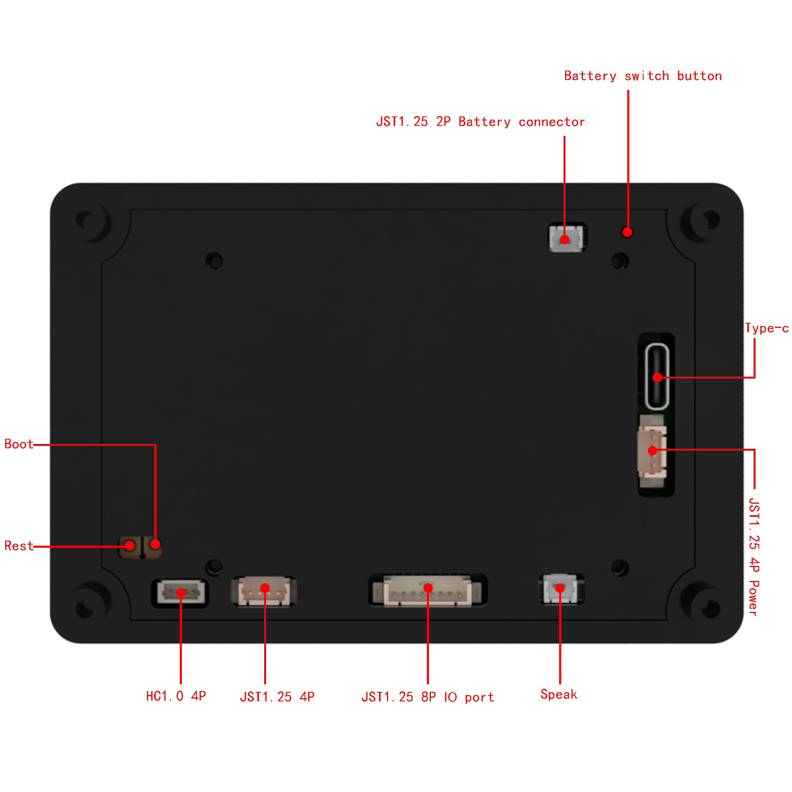
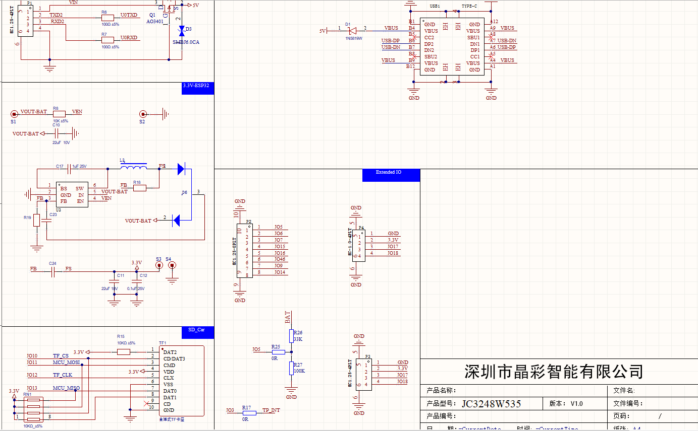
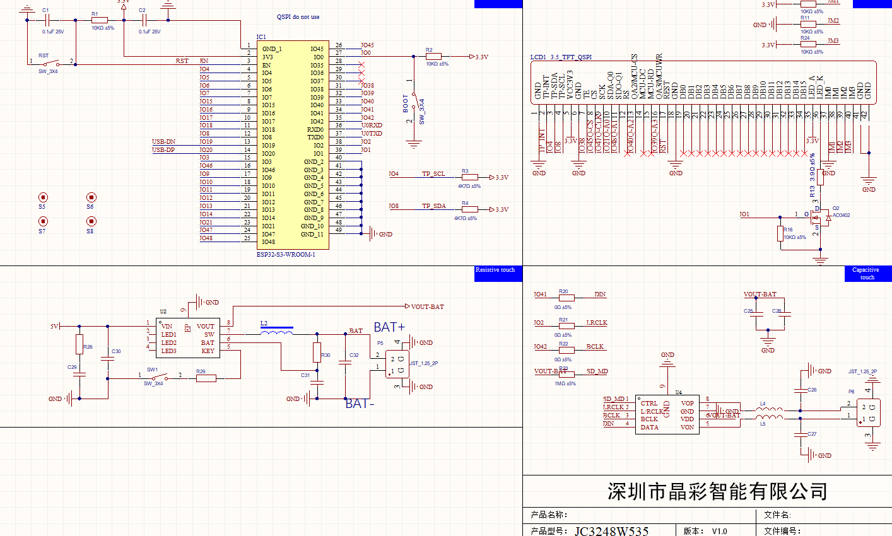

# JC3248W535EN - ESP32-S3 touch panel firmware

Firmware for the Guition JC3248W535EN (a.k.a. "cheap black board"): ESP32-S3, 16 MB flash,
8 MB octal PSRAM, 3.5" 480x320 QSPI display (AXS15231B) with capacitive touch, microSD slot.

A small launcher with apps: Wi-Fi setup, Clock, Weather (Open-Meteo), Files (browser, image
viewer, MJPEG video player), Music (MP3 player), Breakout, Air (Airthings Wave radon sensor over
BLE) and Settings.
UI with LVGL 8.3.

## Build

Plain ESP-IDF 5.5 (CMake / FreeRTOS), built with PlatformIO (`framework = espidf`):

```
pio run            # build
pio run -t upload  # flash over USB
pio device monitor # logs (115200, USB Serial/JTAG)
```

On Windows run PlatformIO from PowerShell or cmd: the ESP-IDF build refuses Git Bash / MSYS.

- Configuration: `sdkconfig.defaults` (the generated `sdkconfig.JC3248W535EN` is not versioned).
- ESP-IDF components (`esp-nimble-cpp`, `esp_new_jpeg`): `src/idf_component.yml`, fetched into
  `managed_components/` on the first build.
- Libraries (LVGL, ArduinoJson, JPEGDEC, PNGdec): `lib_deps` in `platformio.ini`.
- LVGL config: `include/lv_conf.h` (found through `LV_CONF_INCLUDE_SIMPLE`, nothing to copy).

## microSD card

Everything persistent lives on the card (FAT), nothing in internal flash:

| File | |
|---|---|
| `fonts/UI_FONT_16.bin` | UI font with CJK (copy from `documentation/fonts/`) |
| `wifi_known.txt` | saved Wi-Fi networks (written by the Wi-Fi app) |
| `settings.ini`, `timezone.ini` | brightness, units, clock format, speaker volume, shuffle, timezone |
| `music/` | MP3 files for the Music app (subfolders too) |
| `weather.ini` | optional: `lat`, `lon`, `name`, `units` (otherwise IP geolocation) |
| `airthings.ini` | chosen radon sensor (written by the Air app) |
| `breakout.ini` | high score |
| `.cache/mjpeg/` | video frame indexes (rebuilt if deleted) |

Music: MP3 (MPEG-1/2/2.5, CBR or VBR), decoded with minimp3 (vendored in `src/minimp3/`); ID3
title, artist and embedded cover art (JPEG / PNG) are shown. Playback keeps
going in the background; an `.mp3` opened in Files plays that folder. The speaker (2-pin
"Speak" connector) is driven by the on-board NS4168 mono I2S amplifier (BCLK IO42, LRCLK IO2,
DIN IO41), so stereo is mixed down to mono.

Lyrics: a `<song>.lrc` next to the MP3 is used as is (UTF-8; line-synced, word-synced
"enhanced LRC" or plain text). Otherwise they are looked up on [LRCLIB](https://lrclib.net) by
title, artist and duration (needs Wi-Fi) and saved as `<song>.lrc`; songs with no match are
remembered in `.cache/lyrics/`. Title and artist come from the ID3 tag, else from an
"Artist - Title" file name - use the names LRCLIB knows (e.g. the original-language title).

At high volume on a PC's USB port, the amplifier can pull the 5 V supply down far enough that
the board drops off USB and restarts (reset reason "USB reset", no panic). Use a charger or the
battery for loud playback.

Videos: raw MJPEG (`.mjpeg` / `.mjpg`), ideally 480x320; `_15fps` in the file name sets the rate
(default 24).

## Hardware

Datasheets and drawings from the manufacturer are in `documentation/`.

 

 
